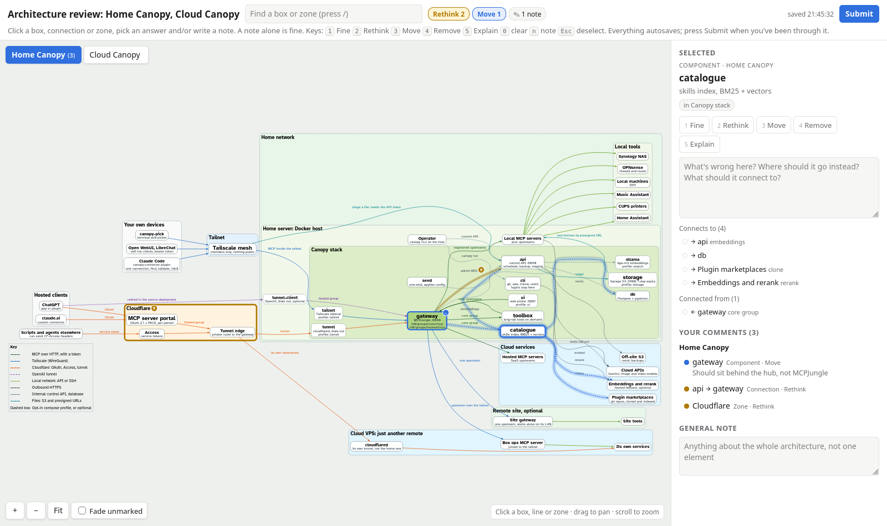

# Feedback

Voice-first feedback from a person to an AI agent, on whatever the agent made. The person reacts
the way people react most precisely and least tiringly, by **talking, pointing at the thing**.
The agent gets back structured feedback that it can act on item by item. Every artefact gets a
local page, and every comment on it comes back anchored to the exact spot it is about:

| Artefact | Mode | How you give feedback |
|---|---|---|
| A document (PDF) | `feedback document` | Drag across words, draw a box or pin a spot, then talk (or type); tag a category (Wording, Typography, Colour, Layout ...); "this page", "whole document"; a verdict per round |
| A long list of items | `feedback new` | One answer per item from a set (Remove / Keep for now / Ask me ...), tick box or free text, with notes |
| A diagram (Graphviz) | `feedback diagram` | Click boxes, connections and zones; answer and/or note |
| Plain text, Markdown, scripts | `feedback text` | Select words and talk; ¶ numbers for paragraphs, 🎙 Section on headings, whole text; script preset adds Delivery / Timing / Pacing and read-aloud times |
| Email drafts (one or a batch) | `feedback email` | ✓ Fine / ✎ Change per field (recipients, subject, attachments, body), pick a subject, select words in subject or body; a verdict per draft ("Approve as is" = send) |
| Images, audio, video | planned | Same model; see [`ROADMAP.md`](ROADMAP.md) |

The framework (what every mode must do, and why voice comes first) is in [`FRAMEWORK.md`](FRAMEWORK.md).

- Stdlib Python 3, no dependencies; `poppler-utils` (`pdftoppm`, `pdftotext`) for documents.
- The server binds `127.0.0.1` and rejects cross-origin writes. Audio stays in the session folder
  until *you* choose where it is transcribed.
- One shared server on one fixed port (default 8790) serves every form at
  `http://127.0.0.1:8790/f/<session>/`; `/` lists the open ones. It starts on demand. Forms live in
  a forms repo: `review/` while open, `done/` once closed (`feedback done`), next to `templates/`
  and `library/`. No port per form, no stray servers.
  `feedback wait` blocks until Submit; `feedback result` gives the structured feedback;
  `feedback outcome` writes back what was done about each comment, and the open page shows it.

## Document review: voice comments on a PDF

```bash
feedback document report.pdf --title "Report v3"     # opens the page
feedback wait                                         # until you press Submit
feedback transcribe                                   # voice comments -> text (your ASR backend)
feedback result                                       # or --json
```

Three tools: **Text** (drag across words: the comment is about exactly that phrase), **Area** (draw a
box: a heading's look, a table's spacing, a chart) and **Pin** (click a spot). Recording starts as
soon as you've pointed; **Stop** or Esc ends it. Each comment gets a **category** chip (Wording,
Structure, Typography, Colour, Layout & spacing, Images & charts, Other; text selections default to
Wording, areas to Layout), and wording comments an optional **intent** (Rephrase, Replace, Delete,
Insert, Keep as is). **This page** and **Whole document** take comments that aren't about one spot,
categorised the same way ("the font is too formal everywhere" → Typography). Each round gets a
**verdict**: Approve as is / Approve with these changes / Needs another round. `result` lists the
comments in reading order with the exact selected text (cut from the PDF, so right-to-left scripts
come out in reading order), what you said and what you wrote:

```
## 3. Page 1 (text) — Wording · Rephrase  [c1k9...]
> selected: "music from the Machane"
> in: "Amplified music from the Machane Yehuda market bars, heard in ..."

Said: Please make the opening paragraph more narrative and less choppy.
```

### Transcription backends

`feedback transcribe` posts each recording to an **OpenAI-compatible** `/audio/transcriptions`
endpoint, so one setting covers hosted and self-hosted engines alike: OpenAI Whisper, Groq,
a speaches / faster-whisper server, whisper.cpp's server, an NVIDIA Parakeet wrapper, LocalAI, or
a desktop app that exposes the API.

```jsonc
// ~/.local/share/feedback-panel/config.json
{ "asr": { "url": "http://my-server:8000/v1", "model": "whisper-1", "key_env": "MY_ASR_KEY",
           "language": "en", "prompt": "Vocabulary: ..." } }
```

or per run: `FEEDBACK_ASR_URL`, `FEEDBACK_ASR_KEY`, `FEEDBACK_ASR_MODEL`, `FEEDBACK_ASR_LANGUAGE`.
With no backend, `feedback transcribe --list` prints the audio files and
`feedback set-transcript <session> <id> -f text.txt` stores a transcript made any other way.

## Text review: scripts, drafts, Markdown

```bash
feedback text script.md --preset script --title "Episode 12 script v2"
```

The text is rendered as a readable page (Markdown: headings, lists, emphasis, links, code; plain
`.txt` keeps its line breaks; `dir="auto"` per paragraph, so Hebrew and English mix). Select any
words and press **Comment on selection**. Click a **¶ number** to comment on a paragraph, or
**🎙 Section** on a heading to comment on everything under it. Every anchor is a character range in
the source file, with the quote, 40 characters either side and the line numbers, so the agent edits
the file directly. `--preset script` adds Delivery, Timing and Pacing, and shows the read-aloud time
(150 wpm) per section and in total.

## Email review: drafts before they're sent

```bash
feedback email draft.json          # one draft, or a JSON list of drafts (one tab each)
```

```jsonc
{ "label": "Legal dept", "from": "me@example.com", "to": ["a@example.org"], "cc": [], "bcc": [],
  "subjects": ["Option A", "Option B"],          // or "subject": "..."
  "body_html": "<div dir=\"rtl\">...</div>",     // or "body_text"
  "lang": "he", "attachments": [{"path": "letter.pdf"}] }
```

Each part of the email (From, To, Cc, Bcc, Subject, Attachments, Body) has **✓ Fine**, one tap, and
**✎ Change**, which starts a voice comment. Proposed subject lines are offered side by side to pick
from. You can select words in the subject or body, and attachments open in a new tab. Each draft
gets its own verdict; **Approve as is** means send it. The HTML body is shown sanitised (no scripts
or handlers), in its own direction. `result` gives, per draft: the verdict, the picked subject, each
field's Fine or Change, and the comments.

## Diagram review

For architecture diagrams, network maps and ER diagrams: the form *is* the diagram. Any Graphviz
`.dot` file becomes a pan-and-zoom page where every box, connection and zone (cluster) is
clickable. Pick an answer (the `architecture-review` template: **Fine / Rethink / Move / Remove /
Explain**) and/or write a note; marked elements get a coloured outline and a badge, the side panel
lists what each element connects to, and a running list of your comments jumps back to each one.



```bash
feedback diagram a.dot b.dot --font-dir fonts/ -o items.json   # one tab per file
feedback new items.json --template architecture-review
```

- Item ids are `<file-stem>:node:<name>`, `<file-stem>:edge:<a>-><b>` (`#2`, `#3` for repeats) and
  `<file-stem>:zone:<cluster_name>`, the names from the `.dot` source, so answers map straight back
  to it.
- `--font-dir` makes `dot` measure text with those fonts and embeds them in the page, so labels
  fit their boxes as in the PDF. `--skip NAME` leaves nodes out (default: `legend`; it is still drawn).
- If the `.dot` is generated (by a build script), the edit belongs in the generator, not the `.dot`.

## Skills

| Skill | For |
|---|---|
| `document-review` | Voice (or typed) comments pinned to a PDF, transcribed, acted on, round after round |
| `text-review` | The same for plain text and Markdown: scripts, drafts, notes |
| `email-review` | Email drafts reviewed field by field before sending, one or a batch |
| `feedback-panel` | The loop: build items, open, read the result, act, report outcomes, offer to keep the form |
| `feedback-form-template` | Pick a template for the answers the user wants, or add a new template |
| `feedback-form-library` | Run a saved form from its recipe, or save a session into the library |

## Install

```bash
cd ~/repos/github/ai-agents-and-prompts/ai-claude-plugins
gh repo clone danielrosehill/Feedback
mkdir Feedback-Forms                                       # your forms repo (templates/, library/, review/, done/), found as ../Feedback-Forms
ln -sf "$PWD/Feedback/bin/feedback" ~/.local/bin/
ln -sf "$PWD/Feedback/bin/feedback" ~/.local/bin/feedback-panel   # old name, still accepted
```

Settings in `~/.local/share/feedback-panel/config.json` (`FEEDBACK_PANEL_HOME`):
`{"port": 8790, "forms_repo": "/path/to/Feedback-Forms"}`; or `FEEDBACK_PORT`, `FEEDBACK_FORMS`.
Sessions from before the shared server: `feedback migrate`. Format: `SCHEMA.md`.

## Used by

- `endpoint-management` › `software-inventory`: every installed program on a Linux machine.
  Its form is the library entry `software-review`.

## History

Renamed from **Feedback-Panel** on 2026-11-19, when document review made the plugin about feedback
in general rather than forms. The `feedback-panel` command is kept as an alias, and the session
folder and environment variables keep their old names, so existing sessions and callers still work.
