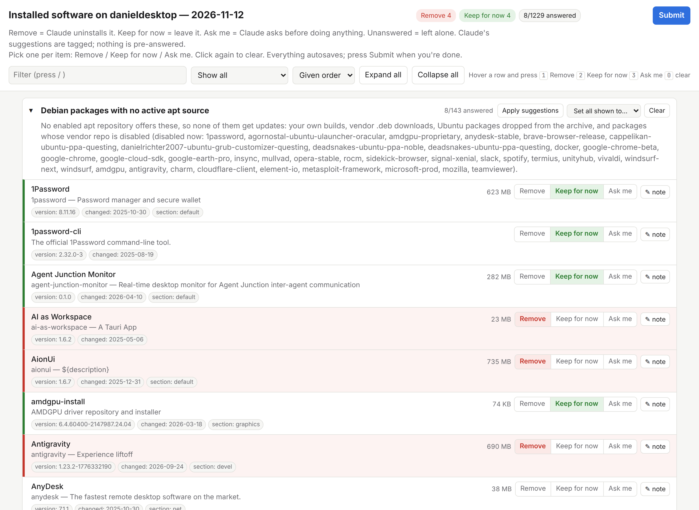

# Feedback-Panel

A Claude Code plugin for decisions with too many items for a terminal multiple-choice question.
Claude writes the items as JSON. `feedback-panel` serves them as a local web form, where each item
gets one answer from a set (e.g. **Remove / Keep for now / Ask me**), a single tick box, or a
free-text reply. The form has search, filters, per-item notes, "Claude suggests" tags and number
keys. Answers autosave to a JSON file that Claude reads back and acts on. Claude then writes an
outcome for each item, which the open page shows.



```
template / library form ─┐
Claude ──items.json──────┴▶ feedback-panel new ──▶ browser form (answer, note, Submit)
                                                        │ autosave
Claude ◀── feedback-panel result ◀── response.json ─────┘
Claude ──feedback-panel outcome──▶ outcomes.json ──▶ page shows done / failed / skipped
```

- Stdlib Python 3, no dependencies. The server binds `127.0.0.1` and rejects cross-origin writes.
- One session per review in `~/.local/share/feedback-panel/sessions/`. `feedback-panel wait`
  blocks until Submit.
- Forms come from the sibling repo
  [Feedback-Panel-Templates](https://github.com/danielrosehill/Feedback-Panel-Templates):
  - `templates/`: generic answer sets.
  - `library/`: forms worth keeping, each with a recipe for rebuilding its items.
  - `feedback-panel save` puts a good session into the library.

## Skills

| Skill | For |
|---|---|
| `feedback-panel` | The loop: build items, open, read the result, act, report outcomes, offer to keep the form |
| `feedback-form-template` | Pick a template for the answers Daniel wants, or add a new template |
| `feedback-form-library` | Run a saved form from its recipe, or save a session into the library |

## Install

```bash
cd ~/repos/github/ai-agents-and-prompts/ai-claude-plugins
gh repo clone danielrosehill/Feedback-Panel
gh repo clone danielrosehill/Feedback-Panel-Templates     # found as ../Feedback-Panel-Templates
ln -sf "$PWD/Feedback-Panel/bin/feedback-panel" ~/.local/bin/
```

Override locations with `FEEDBACK_PANEL_TEMPLATES` and `FEEDBACK_PANEL_HOME`. Format: `SCHEMA.md`.

## Used by

- `endpoint-management` › `software-inventory`: every installed program on a Linux machine.
  Its form is the library entry `software-review`.
